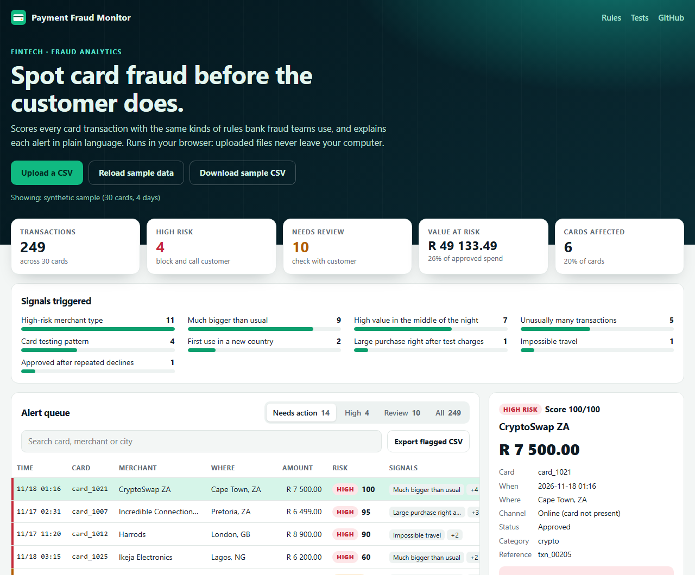

# Payment Fraud Monitor

A fintech fraud-analytics dashboard that scores card transactions with the kinds of rules bank fraud
teams use, and **explains every alert in plain language**: what was suspicious, why it matters, and
what the analyst should do next.

**Try it:** https://bongokuhle-nokubonga.github.io/payment-fraud-monitor/




## What it detects

| Rule | Trigger | Points | Typical fraud |
|---|---|---|---|
| Impossible travel | In-person payments in two cities faster than 900 km/h | 40 | Cloned card |
| Large purchase after test charges | R1 000+ within an hour of a card-testing burst | 35 | Cash-out after card testing |
| Card testing | 3+ charges under R20 within 10 minutes | 30 | Checking a stolen card works |
| Approved after repeated declines | 3+ declines in 30 minutes, then an approval | 30 | Guessing the CVV or expiry date |
| Much bigger than usual | 5× the card's median spend and at least R2 000 | 30 | Account takeover |
| Unusually many transactions | 5+ on one card within an hour | 20 | Spending spree on a stolen card |
| First use in a new country | A country the card has never been used in | 20 | Card used abroad by a fraudster |
| High-risk merchant type | Gambling, crypto, gift cards, money transfer | 15 | Hard-to-reverse cash-out |
| High value at night | R5 000+ between midnight and 05:00 | 10 | Fraud while the customer sleeps |

Points add up (capped at 100): **60+ = High** (block the card and call the customer),
**30-59 = Review** (check with the customer), below 30 = Low. One weak signal alone never blocks a card,
which keeps false positives (and annoyed customers) down.

## Features

- **Alert queue** sorted by risk, with filters (needs action / high / review / all) and search
- **Detail panel** per transaction: every signal with its explanation, the recommended action, and the
  card's recent activity timeline
- **Summary:** transactions, high-risk and review counts, **value at risk** in rand, cards affected,
  and how often each rule fired
- **Upload your own CSV** (processed only in your browser) or use the built-in synthetic sample
- **Export flagged transactions** to CSV for a case-management system

## Built like real payment software

- **Money is stored in whole cents** (integers), never floating point, so R0.10 + R0.20 is exactly R0.30
- **Every rule compares a card with its own history** (median spend, countries seen, last in-person location),
  so a big spender isn't flagged for normal behaviour
- **Thresholds live in one `RULES` object**, so the fraud team can tune them in one place
- **Online purchases are excluded from impossible travel**, because their location isn't reliable
- **Uploaded data is untrusted:** the CSV parser handles quotes and line endings, bad rows are skipped and
  reported by line number, the page only uses `textContent` (a merchant name like `` stays
  plain text), and exported CSV values are protected against spreadsheet formula injection

## Sample data

[`sample.js`](sample.js) generates 249 **synthetic** transactions for 30 cards over 4 days with a seeded random
number generator, so the data is the same every time. It contains planted scenarios (card testing at 2am,
a cloned card used in Johannesburg then London 75 minutes later, declined crypto purchases followed by an
approval, a R18 500 spike, a 3am purchase in Lagos) and a **genuine business trip** from Johannesburg
to Cape Town that must not be flagged. No real card numbers or people.

Use your own data with these columns:

```
id,timestamp,card,amount,merchant,category,city,country,channel,status
txn_1,2026-11-17T14:30:00,card_1001,1299.99,Takealot,online_retail,Johannesburg,ZA,online,approved
```

## Tests

The rules engine is [`fraud.js`](fraud.js), separate from the page. **12 test groups** cover money handling,
CSV parsing and validation, distances, every rule (including cases that must *not* fire, like a genuine
flight or a big spender's normal purchase), score capping, and the full sample: every planted fraud caught,
zero false positives on normal cards.

- In the browser: [`tests.html`](https://bongokuhle-nokubonga.github.io/payment-fraud-monitor/tests.html)
- In Node: `node tests/run.mjs` (runs on every push with GitHub Actions)

## Limitations

This is a transparent rules-based demo. Production systems combine rules like these with machine-learning
models, device fingerprinting and network data, and run on live transaction streams.
